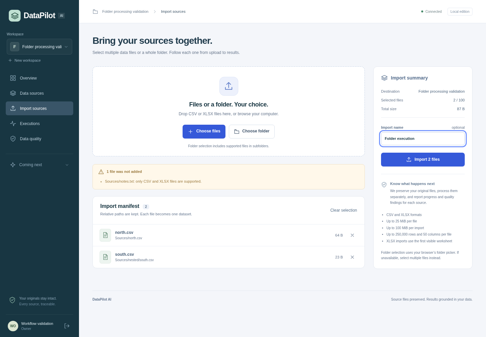

# DataPilot — local data workbench MVP

DataPilot brings local accounts, persistent workspaces, multi-file/folder imports, controlled cleaning, deterministic analytics, saved dashboards, skill-guided AI and exports into one local application. The interface supports English, French and Arabic with right-to-left layout, plus light, dark and system themes. Metrics and answers use actual imported data; local AI mode works without an external API key.

## Update and start

Docker Engine/Compose v2 on Linux is required for the isolated parser. Allow at least 4 GB RAM and 10 GB free disk for builds, application images and local data. From `datapilot/`:

```sh
# First install only: copy .env.example to .env, then review its local credentials.
# When updating, keep your existing .env and named Docker volumes.
sh scripts/dev.sh
```

`dev.sh` builds the services, applies Alembic migrations, starts the worker and waits for API readiness. The development database and objects survive container rebuilds. Do not run `down -v` when updating: it deletes local data. If HTTPS inspection requires a trusted CA, set `DATAPILOT_BUILD_CA_FILE` to its PEM bundle before startup. Verification stays enabled.

Open **http://localhost:3000** after startup. You do not need to install Python or Node on your own machine when using Docker. Existing local accounts, sessions, imported objects and workspaces are preserved by additive migrations when you keep your `.env` and named volumes.

Before saving an external AI key, you may set `DATAPILOT_AI_KEY_ENCRYPTION_SECRET` in `.env` to a long random secret. Keep this value stable across updates and backups. Existing installations can leave it empty: the existing MinIO password is then used to derive the encryption key. Changing the active encryption secret makes saved provider keys unreadable until you re-enter them.



## Your first real execution

1. Open the app and choose **Sign in or create an account**. On the account page select **Create account**. Use your email, name and a password of at least 12 characters. There are no default accounts.
2. Give your first workspace a name and choose **Create workspace**. Workspace data is visible only to its members; a new workspace makes you its owner.
3. Open **Import sources**. Choose multiple CSV/XLSX files, or **Choose folder** to select a folder and its supported files, including nested paths. Unsupported files are shown as excluded. Check the manifest and remove anything you do not want to import.
4. Start the import. Browser upload progress is followed by persisted per-file processing states. Open **Executions** to see queued/running/completed/failed jobs. A malformed file can fail while the other files complete. Retry affects failed files only.
5. Open a completed source to see real row/column counts, the first 100 rows, inferred schema, missing values, quality findings, original relative path and source checksum. Reloading or signing in again restores your workspaces and results.

The folder picker is browser-dependent; multiple-file selection is the fallback. Selecting a folder imports the files once; it does not create a filesystem watcher or a live database connection. Folder hierarchy is metadata, not a path used to write files on the server. Files are imported as independent datasets, not silently joined.

## Clean, analyze and share

1. Open **Cleaning review** and select a ready dataset and its version. Add operations to trim whitespace, turn blanks into missing values, remove exact duplicate rows, remove rows missing a chosen field, fill missing values, rename a column or convert verified numeric text. **Preview cleaning** calculates changes over the full dataset and displays up to 100 result rows. Review the counts, check the approval box, then **Save cleaned version**. The original file and version remain available; select a version explicitly for later work.
2. Open **Analysis setup**. Confirm which columns represent revenue, cost, quantity, date and category; leave unrelated roles unmapped. Optional date/category filters restrict the calculation scope. **Run analysis** saves a version-bound result with decimal arithmetic, coverage counts, exclusions, grouped series and evidence. No currency, joins or business meaning is inferred. Profit and margin use rows with both valid revenue and cost; inspect the calculation evidence before interpreting totals.
3. In **Analysis results** or **Insights**, choose a saved analysis. Review the metrics and charts, then give it a title and **Save dashboard**. **Dashboard** restores saved snapshots tied to their analysis and dataset version; newer imports do not silently change them.
4. Open **AI settings** to choose **Local evidence assistant**, **OpenAI**, **Anthropic** or **Google Gemini**, set the model and optionally save your own API key. Keys are encrypted per account on the server, shown only as a masked hint, and can be removed explicitly. Leaving the key field blank retains the current provider key; changing provider removes the previous provider key unless you supply a replacement. External accounts, model access and usage charges are your provider's responsibility.
5. In **Ask your data**, choose a data-quality, business-analysis or executive-summary skill and enter a question. Local mode returns evidence-based guidance without a key or external request. An external request requires the consent checkbox each time and sends your question, dataset/column names, quality counts and saved analysis aggregates. It does not send raw rows. Answers list evidence and limitations and do not execute generated code or modify your dataset.
6. Open **Export & report**. Export the full selected dataset version as **CSV**, **XLSX** or **JSON**. A saved analysis also offers its filtered data and metadata, a fixed **PDF** report, and a **Power BI package** containing data, mapping, Power Query/DAX guidance and provenance. The Power BI package is a ZIP handoff for Power BI Desktop, not a generated `.pbix` or `.pbit`. CSV/XLSX/JSON retain Unicode source values. The PDF is a fixed English numerical report and escapes non-ASCII text visibly; it does not provide Arabic shaping or localized report typography. The application's language selector changes the browser interface and AI answer language. Spreadsheet exports neutralize formula-like text.

Use the **Language** and **Theme** controls on the account or workspace screen to choose English, Français or العربية and a light, dark or system appearance. Preferences survive browser reloads; Arabic changes the page direction to right-to-left. Imported column names and source values remain as provided.

## Supported files and limits

- CSV and XLSX only. Up to 100 files, 25 MiB per file, 100 MiB per import.
- At most 250,000 rows and 50 columns per dataset. Preview is limited to 100 rows.
- XLSX uses the first visible worksheet. Other worksheets require a separate file; formulas/macros are not executed. Formula-containing workbooks and suspicious/malformed ZIP containers fail with a visible reason.
- Quality checks cover missing values, exact duplicate rows, mixed numeric/text columns and formula-like text. Findings do not modify the original source.
- Original bytes and SHA-256 are preserved; canonical Parquet and metadata are saved. Numeric type inference preserves leading-zero identifiers rather than guessing business meaning.

## Architecture and isolation

Next.js proxies same-origin API requests to FastAPI; HttpOnly SameSite cookies hold opaque sessions whose hashes are stored in PostgreSQL. Passwords use parameterized scrypt with random salts. Session expiry/logout, request-origin checks, login throttling and workspace membership are enforced server-side.

PostgreSQL is authoritative for jobs. One Celery worker with beat dispatches durable queued imports every five seconds; interrupted jobs become retryable failures instead of remaining running indefinitely. Redis carries messages. MinIO stores original files and Parquet.

Every file is parsed in a short-lived bounded subprocess with a scrubbed environment and seccomp network/process restrictions. The Docker worker orchestrator has only the capabilities needed to construct a chroot and drop the parser to a separate non-root UID; its per-job root contains trusted runtime files and that job's staged data. No host or Docker socket is mounted. A kernel Landlock path is also supported for compatible non-root environments; if no supported filesystem boundary can be applied, parsing fails closed. CPU, memory, output and wall-time limits apply. See `docs/SECURITY.md` for deployment limits.

All service ports exposed to the host bind to loopback. The worker requires the explicit capabilities in Compose; removing them without supplying a supported replacement sandbox will make jobs fail. Do not enable privileged mode to work around failures.

## Development and checks

Host development requires Python 3.12, uv 0.12.23 and Node 24:

```sh
sh scripts/cloud-install.sh
uv run ruff check .
uv run ruff format --check .
uv run mypy
uv run pytest -m 'not integration'
NEXT_TELEMETRY_DISABLED=1 npm run build
npm run typecheck
```

Integration tests require two different empty disposable PostgreSQL databases, set through `DATAPILOT_TEST_DATABASE_URL` and `DATAPILOT_FLOW_DATABASE_URL`. Tests refuse nonempty databases. The former tests migration upgrade/downgrade/re-upgrade; the latter tests authentication, authorization, paths, limits and rollback with in-memory object storage. Real storage/worker execution is tested separately:

```sh
python3 scripts/smoke.py
python3 scripts/real-flow-smoke.py
python3 scripts/mvp-flow-smoke.py
node scripts/browser-smoke.mjs
node scripts/browser-mvp-smoke.mjs
```

The real-flow/MVP/browser checks create their own randomly named validation accounts and workspaces. They never log credentials. The MVP checks exercise immutable cleaning, confirmed metrics, dashboard persistence, local skill answers, provider settings and real export downloads; browser checks also cover theme and language preferences. External provider request/response handling is tested with mocked HTTP responses: no successful live provider call is claimed without a configured provider key and reachable endpoint. Browser checks need Chromium (`CHROMIUM_PATH` can select an executable), or Playwright's installed browser. See `docs/VALIDATION.md` for outcomes actually verified.

If the cloud home is read-only, set `UV_CACHE_DIR=/tmp/datapilot-uv`, `npm_config_cache=/tmp/datapilot-npm` and `BUILDX_CONFIG=/tmp/datapilot-buildx`. The cloud install helper already sets its package cache locations.

## API contract

```sh
PYTHONPATH=services/api uv run python scripts/export_openapi.py
npm run api:types
```

The implemented FastAPI contract is exported to `packages/api-contract/openapi.json` and `index.d.ts`; the import/account UI uses these generated types, while workbench types also describe their versioned payloads locally. The current [functional specification](docs/specification/FUNCTIONAL_SPEC.md) describes delivered behavior and acceptance criteria. The original architecture, six-week backlog and proposed contracts are clearly marked historical reference material.

## Repository layout

- `apps/web/`: localized account/workspace/import screens, cleaning/analytics/AI workbench, dashboards, theme controls and same-origin API proxy.
- `services/api/app/features/`: accounts, sessions, membership, imports, immutable cleaning, analytics, dashboards, exports and per-account AI settings/skills.
- `services/api/app/processing/`: deterministic parser, jail, kernel restrictions and launcher.
- `services/worker/`: durable job dispatch and ingestion orchestration.
- `services/api/alembic/`: immutable initial schema plus additive account/workspace, data MVP and encrypted AI settings migrations.
- `infra/`: Compose and API/web/MinIO Dockerfiles.
- `tests/` and `scripts/`: API, migration, parser and live/browser checks.

The official MinIO amd64/arm64 binaries are checked against pinned upstream SHA-256 values. Only amd64 runtime was tested here. MinIO's AGPL license and provenance are in `third_party/`. Review license obligations before deployment or redistribution.
