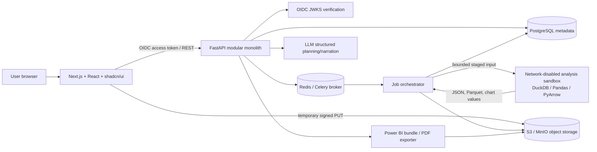
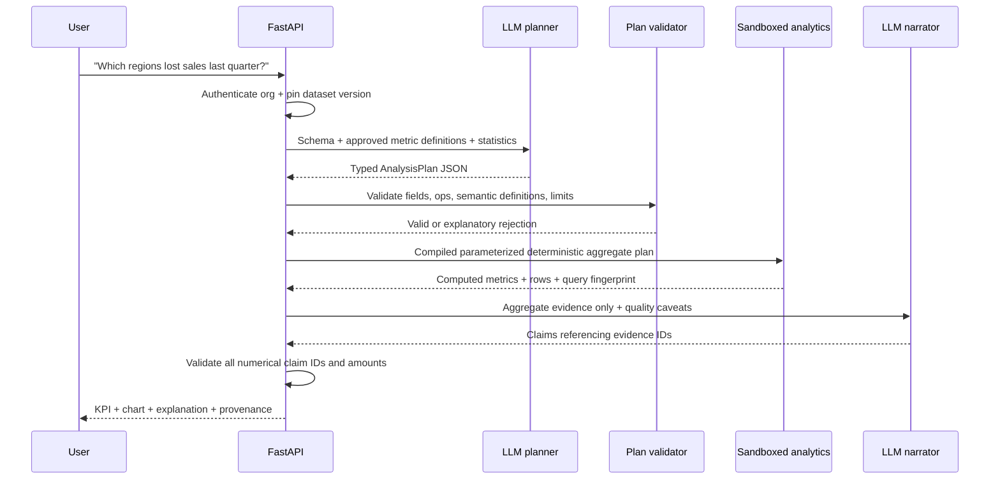

> Historical design reference. For current implemented behavior and acceptance criteria, see [FUNCTIONAL_SPEC.md](FUNCTIONAL_SPEC.md). Features proposed below are not automatically part of the shipped MVP.

# DataPilot AI — MVP Solution Architecture and Six-Week Delivery Plan

**Status:** implementation specification / architectural proposal  
**Version:** 1.0 — October 27, 2026  
**Intended team:** ~3 effective FTE (frontend, backend/data, fractional AI/QA/product)  
**Target:** six-week pilot-ready web MVP; not a certified enterprise deployment.

## Executive decision record

Build a **Python-first modular monolith** with a Next.js frontend, FastAPI REST API, PostgreSQL metadata, S3-compatible object storage, Celery/Redis for asynchronous jobs, and isolated DuckDB/Pandas workers. Add a restricted LLM planner/narrator that generates **declarative analysis plans**, not executable Python or arbitrary SQL. Ship a **Power BI-compatible export bundle and a manually authored Power BI Desktop `.pbit` template**; automate Power BI workspace publishing/embedding only after the pilot validates licensing, tenancy, and costs. Use the AAS library to guide the *development agent*, not to run customer analysis workflows.

### Working assumptions (change-control triggers)

- Browser-based product in English, with Arabic/French localization architecture, not fully translated in MVP.
- Organizations, with `owner`, `analyst`, `viewer` memberships; one active org per request.
- CSV and XLSX only (one selected worksheet per ingestion). No live database connections in v1.
- Target dataset limits: <=25 MiB compressed upload, <=250,000 rows, <=50 columns, one tab at a time. Reject excessive/corrupted files safely.
- Dataset source is **immutable**; cleaned result creates a separate version.
- No assumption that a dataset contains `revenue`, `cost` or `profit`; user confirms semantic mappings before relevant KPIs are offered.
- No silent AI-generated cleaning, no unrestricted code interpreter, and no data sent to an LLM by default beyond schema and aggregate statistics.
- Native dashboards inside DataPilot; separate optional Power BI workflow.
- Managed OIDC provider for authentication with backend token verification. Provider selection is an implementation parameter.

## 1. User journey and screen contracts

| Screen | Route | MVP deliverable | Backend dependency |
|---|---|---|---|
| Welcome/sign-in | `/sign-in` | managed login | OIDC |
| Home | `/app` | recent datasets and start buttons | list datasets |
| Upload/configure | `/app/datasets/new` | drag-drop CSV/XLSX, name and worksheet choice | presign + finalize |
| Dataset preview | `/app/datasets/:id` | 100-row preview, inferred schema, column types and semantic mapping | preview/schema |
| Data-quality report | `/app/datasets/:id/quality` | findings with severity, counts and distributions | quality findings |
| Cleaning review | `/app/datasets/:id/clean` | proposal checkboxes, preview impact, explicit approval | cleaning plan + apply |
| Analysis setup | `/app/datasets/:id/analyze` | question + templates + metric mapping | analysis create |
| Analysis results | `/app/analyses/:id` | KPI cards, reproducible tables/charts | analysis result |
| Insights | `/app/analyses/:id/insights` | findings with evidence and limitations | evidence-backed insights |
| Dashboard | `/app/dashboards/:id` | line, bar, table, filter controls | dashboard spec |
| Ask your data | `/app/datasets/:id/ask` | guided natural-language Q&A with provenance | NL question endpoint |
| Export/report | `/app/analyses/:id/export` | PDF and BI export bundle | report/export jobs |

Every screen must have empty, loading, asynchronous progress, error, access-denied and completed states.

## 2. System architecture



**Trust boundaries:** (1) web requests are authenticated and organization-scoped; (2) uploaded files are untrusted; (3) LLM output is untrusted and schema-validated; (4) sandbox processes have no direct database or network access; (5) download links are short-lived and organization-authorized; (6) external Power BI access is an explicitly configured optional path.

### Deployment topology

- `web`: Next.js, stateless, behind TLS ingress.
- `api`: FastAPI, stateless; Pydantic validation, DB sessions, auth/RBAC, job queueing.
- `worker`: Celery orchestration, no direct arbitrary user code execution.
- `analysis-runner`: **short-lived rootless sandbox** invoked per dataset processing/analysis job. Workers stage input inside per-job ephemeral directory and collect a strictly typed result manifest.
- `postgres`: transactional metadata only, no uploaded full dataset blobs.
- `redis`: background queue, progress/cache, never authoritative durable state.
- `object-store`: original files, versioned Parquet, exported CSV/PDF bundles.
- `monitoring`: structured logs, error tracking, job metrics, p95 latencies.

## 3. Technology choices

| Component | Choice | Why | MVP notes |
|---|---|---|---|
| Frontend | Next.js App Router / TS | composable responsive SaaS UI | server and client components; tested accessible forms |
| UI | shadcn/ui + Tailwind CSS | fast, consistent modern components | use 12 wireframes as acceptance guide |
| Charts | Recharts | native dashboards | only approved chart grammar, not arbitrary code |
| REST | FastAPI + Pydantic | strong typed contracts | `/api/v1`, OpenAPI generated |
| DB | PostgreSQL + SQLAlchemy 2 + Alembic | stable transactional schema | `org_id` on each resource |
| Jobs | Celery + Redis | resilient asynchronous processing | status persisted in Postgres |
| Analytics | DuckDB + Pandas + PyArrow | columnar analytical computations | isolated runner, bounded results |
| File storage | AWS S3/MinIO | scalable objects and signed URLs | encryption and lifecycle TTL |
| PDF | Jinja HTML + WeasyPrint | stable templated reports | no generated browser scripts |
| AI | Model adapter + JSON Schema/Pydantic | vendor-independent model routing | strict declarative plans |
| Auth | OIDC SaaS provider | avoid building password system | JWKS, issuer, audience verification |
| Infra | Docker Compose dev; managed cloud production | reproducible local development | hardening as release gate |

Use pinned dependency versions and publish SBOM/security scan before a pilot; do not rely on floating `latest` tags.

## 4. Domain model and state machines

Metadata tables: `organizations`, `users`, `memberships`, `datasets`, `dataset_versions`, `jobs`, `quality_findings`, `cleaning_plans`, `analyses`, `dashboards`, `conversations`, `messages`, `reports`, `exports`, and `audit_events`. See `schema.sql` for proposed PostgreSQL DDL.

- Dataset version: `uploaded -> validating -> profiling -> ready | failed`; cleaning creates a *new* version.
- Job: `queued -> running -> succeeded | failed | cancelled` (cancellation best-effort); failed jobs keep a sanitized error code, retry policy and attempt counter.
- Cleaning plan: `proposed -> approved -> applied | rejected | failed`; preview is non-destructive.
- Analysis: `queued -> running -> completed | failed`; all outputs reference one immutable input version.

Every query filters by organization and verifies membership at the API/service layer. Apply additional DB RLS when preparing wider production rollout; never rely on IDs from the browser as authorization.

## 5. File ingestion and data-contract semantics

**Upload flow**

1. UI requests presigned upload using name, declared MIME, size, SHA-256; API enforces size and organizational quota, creates pending upload ID.
2. Browser uploads directly to quarantine object key; UI calls finalize.
3. API validates object existence and verified server-side size/checksum, queues ingestion, does not trust browser MIME or claimed SHA.
4. A constrained sandbox examines file signatures, container format, sheet names, encoding, delimiter and parser integrity; no VBA macros or formulas are executed.
5. Successful import writes an immutable canonical Parquet version with hash, schema, inferred data types, statistics, 100-row preview with sensitive-field masking where applicable.
6. Worker runs quality checks; source status becomes `ready` and user confirms semantic roles (date, revenue, cost, quantity, product, region) as needed.

**Quality rules**: null/blank rates, duplicated rows and declared ID duplicates, date parse failures, numeric parse failures, categorical inconsistency, outliers (flag, do not automatically remove), negative value review (not automatically an error), mixed currency checks, and unit/amount plausibility where explicit domain rules exist.

**Cleaning operations** (allowlist): `drop_exact_duplicates`, `trim_string`, `normalize_date`, `fill_missing_constant`, `fill_missing_median` (numeric only), `cast_type`, `map_category`. Require operation preview (affected row count and before/after examples), version lineage, audit events and explicit approval. Rejection leaves version untouched. Refuse operations resulting in invalid/downstream breaking mappings.

**Metrics**: use a semantic registry. `revenue = SUM(revenue_field)` only after currency handling and semantic mapping; `profit = SUM(revenue) - SUM(cost)` only if those are valid cost/revenue measures at compatible granularity; `margin = profit/revenue` only if denominator nonzero. Dates and comparisons always specify inclusive/exclusive date windows and timezone/currency conventions. No guessed business definitions.

## 6. AI architecture — bounded, evidence-first



**No generic agent autonomy in v1.** Use a small, well-defined tool catalogue: `describe_dataset`, `get_quality_summary`, `suggest_semantic_mapping`, `propose_analysis`, `execute_validated_plan`, `describe_result`, `create_chart_spec`, `render_report`. These are application-owned tools, independent of AAS.

Example restricted plan (no SQL or Python submitted by model):

```json
{
  "dataset_version_id": "UUID_FROM_AUTHENTICATED_CONTEXT",
  "intent": "compare_trend",
  "group_by": ["region"],
  "metrics": [{"id": "revenue", "aggregation": "sum"}],
  "filters": [{"field": "order_date", "op": "within_last_complete_quarter"}],
  "compare_to": "previous_complete_quarter",
  "sort": {"metric": "revenue_delta_pct", "direction": "asc"},
  "limit": 10
}
```

Backend must substitute the *authorized* dataset version, validate group fields, metric registry, allowed filter ops and cardinality, then compile with quoted identifiers/parameters. A plan cannot reference arbitrary file paths, external URLs, Python imports, extensions or operating-system commands. Reject unsupported questions rather than inventing answers.

**Grounding controls:** Persist result provenance (`dataset_version_id`, filter parameters, metric IDs, query fingerprint, computed figures, row counts and quality caveats). Narrator may only cite evidence IDs; verify numerical quantities against the result JSON before display. Label observational findings as associations/contributors, not established causal explanations. Produce clarifying requests when no valid metric mapping exists.

**LLM privacy:** send schema, business glossary, aggregate metrics and optional redacted exemplars only with tenant-controlled opt-in; never transmit full raw uploads by default. Strip PII, limit context/tokens, define data processor obligations, log model/prompt versions but not sensitive rows. Treat cell contents as untrusted text, not executable instructions.

## 7. Isolation and security baseline

- Separate short-lived analysis containers or microVMs; Linux non-root UID, read-only root filesystem, bounded ephemeral storage, no host/container socket mounts, no privileged mode.
- Network disabled inside the runner. The worker stages bounded input, checks signature/size and copies verified data in; it collects outputs, never sends production credentials in.
- CPU/memory/time/row limits; illustrative starting defaults: 1 vCPU, 1 GiB memory, 120 seconds, 2 GiB scratch, <=50 output columns, <=5,000 aggregate output rows. Tune with measurements.
- Deny installation/loading of DuckDB extensions from untrusted analysis content; use application-constructed SQL only. SQL allowlists *in addition to*, not instead of, OS isolation.
- Malware/formula/CSV-injection tests, XLSX archive-bomb protection, upload quotas, tenant throttles, outbound egress checks, stored XSS escaping.
- OIDC JWT issuer/audience/expiry verification; RBAC for each org resource and every download; audit events for upload, cleaning approval and export.
- TLS, envelope/encryption-at-rest for storage, managed secrets, credential rotation; TTL and delete/export workflows. Establish privacy policy, region/residency and retention before production customer data.
- Rate-limit NLQ per org/user; cap model usage budget and output tokens; do not return stack traces to browsers.

## 8. Frontend state and dashboard contract

Use React Query/TanStack Query for cache/job polling. Charts derive only from server-calculated typed arrays, never model-supplied JS. Suggested chart types: `line`, `bar`, `table`, `kpi` (pie/donut optional); filters for date, region and product. Dashboard JSON refers to metric IDs, group dimensions and chart types; no HTML/JS fragments allowed.

Example render spec:

```json
{
  "title": "Sales overview",
  "dataset_version_id": "uuid",
  "widgets": [
    {"type": "kpi", "metric_id": "revenue", "label": "Revenue"},
    {"type": "line", "metric_id": "revenue", "dimension": "order_month"},
    {"type": "bar", "metric_id": "revenue", "dimension": "region", "limit": 10}
  ]
}
```

All KPI cards show period and currency/unit, source version, handling of missing data and (where relevant) comparative baseline.

## 9. REST API

- `GET /api/v1/me`, `GET /api/v1/organizations/current`
- `POST /api/v1/uploads/presign`, `POST /api/v1/uploads/{id}/finalize`
- `GET /api/v1/datasets`, `GET /api/v1/datasets/{id}`, `GET /api/v1/datasets/{id}/versions/{version_id}/preview`, `GET /api/v1/datasets/{id}/quality`
- `PUT /api/v1/datasets/{id}/semantic-mapping`
- `POST /api/v1/datasets/{id}/cleaning-plans`, `POST /api/v1/cleaning-plans/{id}/preview`, `POST /api/v1/cleaning-plans/{id}/apply`
- `POST /api/v1/analyses`, `GET /api/v1/analyses/{id}`, `GET /api/v1/analyses/{id}/insights`
- `POST /api/v1/questions`, `GET /api/v1/questions/{id}` (async NLQ)
- `POST /api/v1/dashboards`, `GET /api/v1/dashboards/{id}`
- `POST /api/v1/reports`, `POST /api/v1/exports/powerbi`, `GET /api/v1/exports/{id}`
- `GET /api/v1/jobs/{id}`, `GET /api/v1/files/{id}/download-url`

All mutating POST requests support `Idempotency-Key` where practical. Large/long tasks return `202 Accepted` with a `job_id` and polling link. Use `401` for no auth, `403` for insufficient permissions, `404` for inaccessible tenant-scoped IDs, `409` for state conflicts, `413` for file size, `422` for validation, `429` for quota, and `500` as sanitized generic internal errors. See `openapi.yaml` for a starter contract; generate the full formal OpenAPI from FastAPI implementation and keep it under CI snapshot testing.

### Example asynchronous response

```json
{
  "job_id": "53cfa1a8-5b23-44f1-b5cc-68da5f6b2ee2",
  "status": "queued",
  "status_url": "/api/v1/jobs/53cfa1a8-5b23-44f1-b5cc-68da5f6b2ee2"
}
```

## 10. Power BI integration — honest six-week scope

**MVP (week 6):** implement a single **Power BI export package** endpoint, producing:

```text
powerbi_export_<dataset_version>.zip
├── fact_sales.csv                # only if mapping supplies mandatory fields
├── dim_date.csv
├── dim_product.csv               # optional
├── dim_region.csv                # optional
├── data_dictionary.csv
├── measures.dax                  # curated DAX suggestions; review before usage
├── mapping.json                  # source schema, typed field mapping, units
├── manifest.json                 # lineage, version, checksums, export time
└── README_POWERBI.md             # load/parameter setup, security notes
```

Deliver one **manually authored** `.pbit` template with parameter `ExportFolder` and approved, known schema. When required semantic fields are absent, block the fixed sales template and offer a generic cleaned-data CSV export instead. Do not claim arbitrary layouts, PBIX binary authoring or refresh will work automatically.

**After MVP / feature-gated PoC:** Microsoft Entra service principal, workspace authorization, REST import of a vetted PBIX template, dataset-parameter updates and refresh; restrict to pilot tenant and a preconfigured Power BI workspace. Microsoft documents the service-principal configuration and APIs, and embedding for external SaaS customers incurs **production capacity/licensing requirements**. Don't include multi-tenant external embedding in the six-week acceptance gate.

Microsoft references:
- https://learn.microsoft.com/en-us/power-bi/guidance/develop-scalable-multitenancy-apps-with-powerbi-embedding
- https://learn.microsoft.com/en-us/power-bi/developer/embedded/embedded-capacity
- https://learn.microsoft.com/en-us/rest/api/power-bi/

## 11. AAS skills — used by Codex/Claude developers, NOT the product runtime

AAS Core is a local developer-agent skill catalog and validated stack preview; its `compose_stack` does not run analysis or certify skills safe. Read the repository release and pin exact versions/IDs, audit upstream license of each selected skill, dry-run an install and commit selection evidence.

Recommended *candidate skills* to inspect in AAS before installation (not an asserted ready-made manifest):

| Workstream | Candidate skill | How to use it |
|---|---|---|
| Semantic modeling | `business-analyst` | user stories, metric questions, definitions |
| Query engine | `sql-pro` | deterministic analytical SQL, windowing, tests |
| Quality engine | `data-quality-frameworks` | reproducible null/dup/type rules |
| Dashboard | `kpi-dashboard-design` | role-focused metrics and charts |
| Narrative | `data-storytelling` | evidence-led explanations and uncertainty |
| Data pipeline | `dbt-transformation-patterns` | transformation patterns, adapt to DuckDB MVP |
| Performance | `sql-optimization-patterns` | SQL plan and semantic regression review |
| DB design | `postgres-best-practices` | PostgreSQL migration/index review |
| API/agents | `ai-agents-architect`, `agent-evaluation` | typed tool boundaries and evaluation |

Fork starting point: https://github.com/morluto/agentic-awesome-skills/blob/main/README.md  
Original bundle reference: https://github.com/sickn33/agentic-awesome-skills/blob/main/docs/users/bundles.md

Suggested local procedure (read the exact Core guide first, and verify compatibility with pinned package):

```sh
# Inspect and audit skills before installing anything
npx agentic-awesome-skills audit --skills business-analyst,sql-pro,data-quality-frameworks,kpi-dashboard-design,data-storytelling
npx agentic-awesome-skills --skills business-analyst,sql-pro,data-quality-frameworks,kpi-dashboard-design,data-storytelling --dry-run
# Execute reviewed install only if the pinned package version and paths match the verified documentation.
```

The AAS skill library is an instruction/knowledge aid for Codex/Claude creating the software. Implement application-owned analysis tools and strict contracts regardless of selected developer skills.

## 12. Engineering repository layout

```text
datapilot/
├── apps/
│   └── web/                     # Next.js app router, screens, chart components
├── services/
│   ├── api/                     # FastAPI routes, services, RBAC, Pydantic contracts
│   │   ├── app/api/v1/
│   │   ├── app/core/            # auth, config, audit, organization scope
│   │   ├── app/models/          # SQLAlchemy entities
│   │   ├── app/domain/          # ingestion, quality, cleaning, metrics
│   │   ├── app/ai/              # model adapter, planner, evidence checks
│   │   └── alembic/
│   ├── worker/                  # Celery dispatch and orchestration
│   └── runner/                  # ephemeral sandbox entrypoint, no secrets
├── packages/
│   ├── api-contract/            # OpenAPI generated TS types
│   └── metric-definitions/      # versioned KPI registry/tests
├── powerbi/
│   ├── templates/               # human-built .pbit
│   ├── samples/                 # sanitized golden sample datasets
│   └── docs/
├── tests/
│   ├── integration/
│   ├── security/
│   ├── golden_analysis/
│   └── e2e/
├── infra/
│   ├── docker-compose.yml
│   ├── docker/                   # locked-down runner definitions
│   └── deployment/
├── docs/
│   ├── ARCHITECTURE.md
│   ├── openapi.yaml
│   ├── ADRs/
│   └── RUNBOOK.md
└── .github/workflows/ci.yml
```

## 13. Six-week delivery roadmap

### Week 1 — Foundation / UX skeleton

**Build:** monorepo, CI, Docker local environment, Next.js design system/routes, OIDC authentication, org creation/membership, PostgreSQL Alembic baseline, storage + Redis integration. Create seeded demo tenant and fixtures. Design acceptance: all 12 route skeletons navigable, at least 3 roles protected, cross-tenant access denied.

**Gate:** signed-in user can access only permitted datasets and see a clean home screen. No real uploaded data yet.

### Week 2 — Upload, preview and schema

**Build:** signed upload/finalize, strict file validation, isolated CSV/XLSX parsing, sheet choice, immutable version + Parquet, inferred schema, preview with pagination, jobs/progress, telemetry and quota tests.

**Gate:** real CSV/XLSX (up to target bounded limits) uploads and produces a typed 100-row preview without escaping the sandbox; malformed files fail safely.

### Week 3 — Quality and controlled cleaning

**Build:** missing/duplicates/type/date check suite, quality detail page, cleaning operation allowlist, before/after preview, approved application with version lineage, per-tenant audit events.

**Gate:** user explicitly approves cleaning, original bytes remain unchanged, a distinct cleaned version is produced, all changes are traceable.

### Week 4 — Analytics and native dashboards

**Build:** semantic mapping forms, KPI registry, deterministic DuckDB aggregate compiler, date comparisons, charts, dashboard templates (sales/operations), stored analysis result/evidence and CSV drill-down.

**Gate:** 10 golden analyses produce reproducible numbers on test fixtures; cards/charts match the same results and correct period/currency.

### Week 5 — Natural language, insights, PDF

**Build:** structured-output LLM plan generation, strict validator, safe execution routing, evidence-linked narrator, question history, ambiguity/unsupported states, fixed-format PDF generation and export jobs.

**Gate:** at least 19/20 pre-agreed benchmark business questions produce numerically correct supported results or an appropriate refusal/clarification; no unsupported numerical claims.

### Week 6 — Power BI handoff and pilot readiness

**Build:** validated export ZIP, manually built `.pbit` sales template, integration guide, security/tenancy review, e2e regression, load tests, observability alerts, backup/restore drill, pilot deployment, demo and pilot onboarding.

**Gate:** independent tester uploads a sample spreadsheet, cleans it with approval, asks a supported question, gets a traceable dashboard, downloads a PDF, and loads the compatible export through Power BI Desktop. Tenant-isolation and negative security tests pass.

### Sprint capacity and dependencies

Assume two full-time engineers and a part-time product/UX/QA/AI contributor (approximately three effective FTE). A solo developer should treat six weeks as a prototype target and reduce scope further. Critical path: `auth + object storage -> sandbox ingestion -> typed versions -> quality + mapping -> metric engine -> safe AI -> exports`. Power BI work can begin in parallel in week 4 once a canonical sales schema exists.

## 14. Delivery gates and performance targets

Targets (validate with representative fixtures, **not guaranteed SLAs**):

- 25 MiB upload accepted/denied safely; <=250k rows / <=50 columns; processing <=90s on benchmark infrastructure for standard samples.
- API p95 <500ms for simple metadata reads (excluding queued long-running jobs).
- At least 20 golden NLQ questions, >=95% with numerically verified outputs or correctly flagged unsupported requests.
- All displayed numeric statements link to saved evidence; no invented metric values in approved test set.
- Tenant A cannot fetch Tenant B IDs, jobs, reports, objects or export URLs (automated tests).
- All destructive cleaning actions require explicit approval and create a new immutable version.
- Baseline dependency/container scan: no unresolved critical vulnerabilities in deployed images at go/no-go.
- Backup restoration and job retry demonstrated, browser and API errors observable.
- Successful `.pbit` import/repoint for fixed sales schema in a licensed/configured Power BI Desktop environment.

## 15. Test strategy

- **Unit:** mapping types, KPI calculations, division by zero, chart schemas, cleaning operations.
- **Property-based:** malformed schema/type/column names and arbitrary UTF-8 strings must never become SQL or scripts.
- **Integration:** S3 upload lifecycle, Celery idempotency, version lineage, failed and retried jobs, JWT enforcement.
- **Golden data:** fixed sales fixtures with known totals, returns, duplicates, mixed currencies, missing values, partial dates, invalid codes.
- **Security:** JWT audience tampering, org-ID swapping, presigned object leakage, zip bombs, malicious formulas, CSV formula injection, SQL injection, prompt injection in spreadsheet cells, network egress and memory/CPU limits.
- **End-to-end:** 12 screens, keyboard navigation, file upload to PDF and Power BI.
- **Recovery:** crash during cleaning leaves original intact and job transitions to recoverable failure.

## 16. Major risks / mitigations

| Risk | Consequence | Mitigation |
|---|---|---|
| Arbitrary client spreadsheets have inconsistent semantics | bad KPI recommendations | semantic mapping/metric contracts and user approval |
| LLM invents explanation | trust/reputation risk | constrained JSON plan, evidence validation, explicit uncertainty |
| File/SQL attack | data breach/host compromise | hardened isolated runner, no arbitrary SQL/code, scanning |
| Cross-tenant data leaks | unacceptable SaaS failure | org-scoped service access + negative tests + signed URL auth |
| Power BI licensing/embedding complexity | schedule overrun | file/template first, embed deferred |
| Slow large imports | poor UX | async jobs, quotas, progress, Parquet, indexes |
| Skill supply-chain risks | unsafe coding-agent instructions | minimal selected AAS skills, license/command audit, version pinning |
| Six-week scope inflation | missed pilot | feature flags, no live connectors/forecasting/embedding in v1 |

## 17. Build order for Codex

1. Read `ARCHITECTURE.md`, `schema.sql`, `openapi.yaml`, `CODEX_TASKS.md`; do not invent additional scope.
2. Create root monorepo, developer Docker Compose, CI and tests.
3. Implement authentication, organization isolation, and metadata migrations.
4. Implement upload/preview with the isolated runner; avoid code execution from file data.
5. Implement quality/cleaning with user approval + versioning.
6. Implement approved metric definitions + deterministic query compiler and dashboard data APIs.
7. Implement structured-model planner, evidence verification and 20-question evaluation suite.
8. Implement PDF, Power BI handoff, end-to-end coverage and pilot deploy.
9. Each PR must include tests, migration notes, exact API contract changes, and security review points.

## 18. What this specification intentionally does not promise

No production embedding without Power BI capacity and tenant configuration; no direct Power BI report binary generation; no unrestricted enterprise database connector; no automatic model training; no guaranteed causal analysis; no assertion that AAS instructions are verified executable software; and no guarantee that all arbitrary user spreadsheets can be interpreted without a business glossary.

**Definition of success:** a pilot customer can use its ordinary sales spreadsheet to get transparent analysis and a dependable report without hiring a full-time analyst, while the operator can audit and reproduce each numerical claim.
